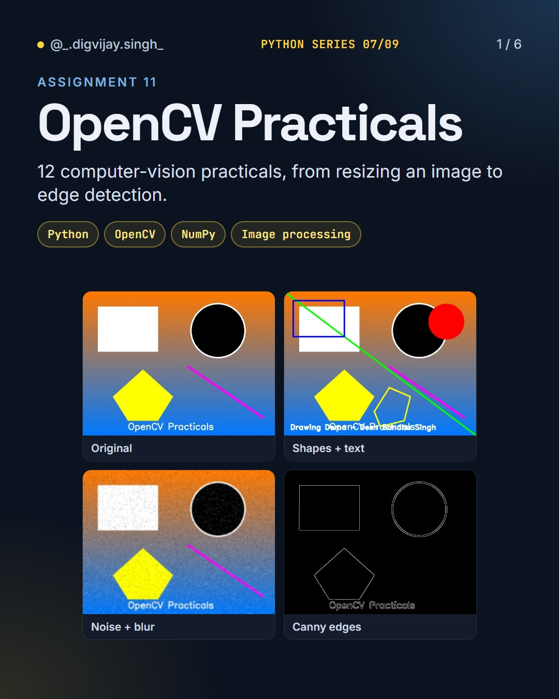
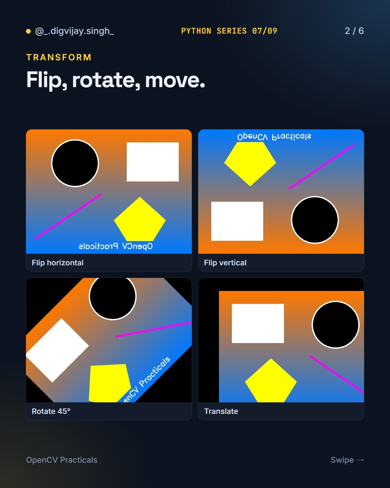
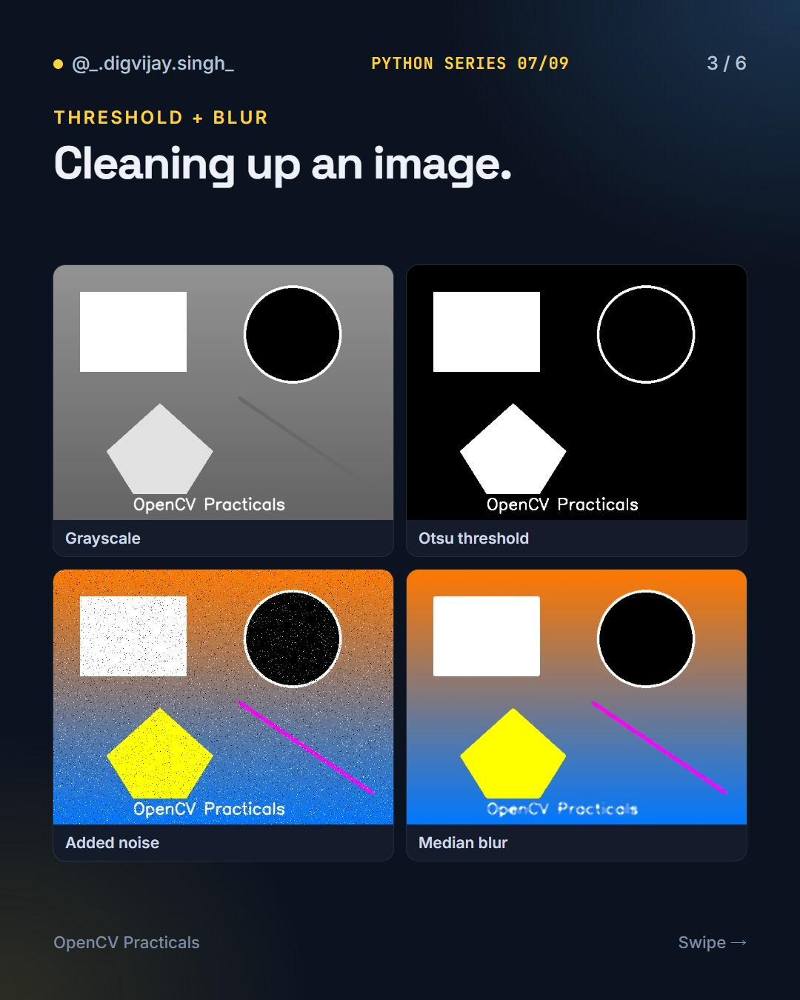
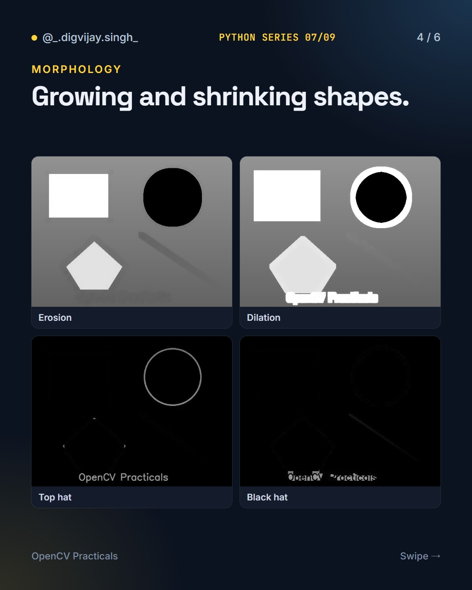
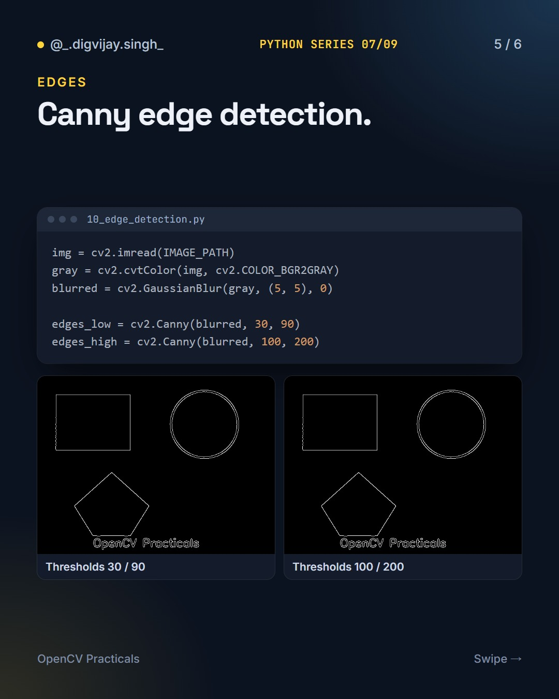
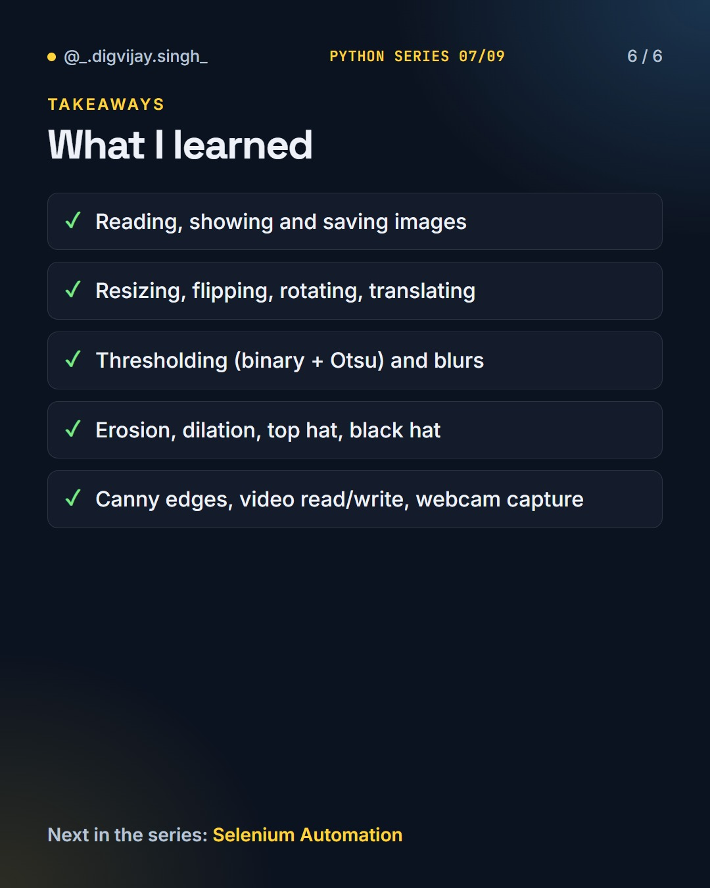

# OpenCV Practicals

<p align="center"></p>

12 computer-vision practicals in Python with OpenCV, from reading and resizing an image to Canny edge detection and webcam capture.

Part 7 of 9 in my **Python Series**.

## How to run

```bash
pip install -r requirements.txt
cd code
python 01_read_display_save.py
```

Every practical (01–12) runs the same way. The sample image and video are generated automatically on first run, and results are written to `outputs/`.

The original assignment notes are in [NOTES.md](NOTES.md).

## What I learned

- Reading, showing and saving images
- Resizing, flipping, rotating and translating
- Thresholding (binary + Otsu) and blurs
- Erosion, dilation, top hat and black hat
- Canny edges, video read/write and webcam capture

## Slides

<p>





</p>

## The Python Series

1. [Python Basics](https://github.com/digvijay165/python-basics)
2. [Tkinter Calculator](https://github.com/digvijay165/tkinter-calculator)
3. [Python + PostgreSQL](https://github.com/digvijay165/python-postgresql)
4. [Flask Registration Form](https://github.com/digvijay165/flask-registration-form)
5. [Django REST Blog API](https://github.com/digvijay165/django-rest-blog-api)
6. [Python Web Scraper](https://github.com/digvijay165/python-web-scraper)
7. **OpenCV Practicals**
8. [Selenium Automation](https://github.com/digvijay165/selenium-automation)
9. [Python Chat App](https://github.com/digvijay165/python-chat-app)
